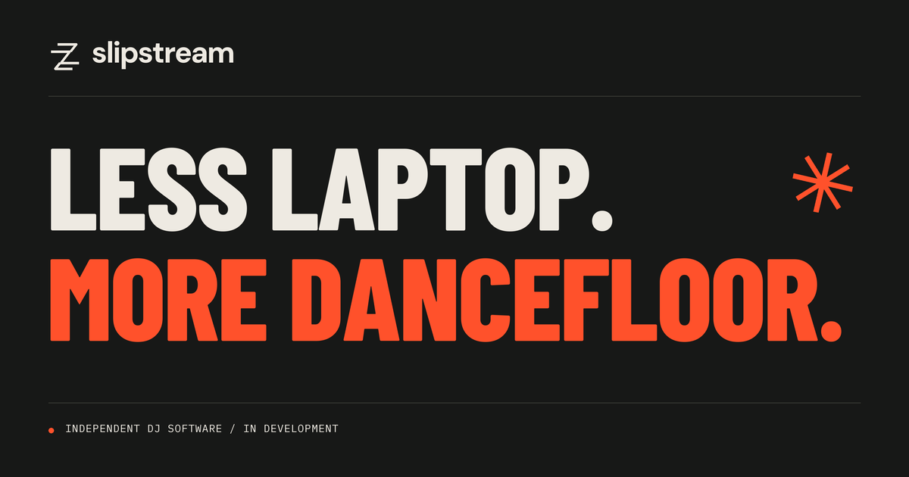

<p align="center">
  <a href="https://slipstream-dj.vercel.app/">
    
  </a>
</p>

# Slipstream

**Your music. Your controls. Get lost in the mix.**

Slipstream is an experimental DJ system for standalone hardware: a Rust audio
engine, a Qt interface, and a Linux foundation. The goal is a dedicated instrument
you can plug your collection into and play.

[**Play the sound study ↗**](https://slipstream-dj.vercel.app/#playground)
&nbsp; · &nbsp; [Run locally](#run-it-locally)
&nbsp; · &nbsp; [Explore the roadmap](docs/ROADMAP.md)
&nbsp; · &nbsp; [Contribute](#build-with-us)

> **On the workbench.** This is active development, with unfinished controls,
> ongoing engine work, and hardware performance still being validated. The
> website's playable demo is an independent Web Audio sound study with original
> synthesized loops; it does not run the native Slipstream engine.

## Built around the set

- **Bring your collection.** Browse USB libraries and read legacy Rekordbox
  exports, including track metadata and analysis data.
- **Keep your hands on the music.** The DDJ-FLX10 is the first controller
  integration target, with MIDI input, control mapping, and LED feedback.
- **See where you're going.** A Qt/QML interface brings together the library
  browser, player views, and waveform display.
- **Go beyond the laptop.** The repository includes an experimental NixOS image
  configuration targeting Raspberry Pi 5.

The native application targets Linux today. MIDI support is specific to the
DDJ-FLX10; audio prefers the FLX10 and falls back to the host's default output.
Library writeback, OneLibrary, Engine DJ, Pro DJ Link, recording, and stems remain
unfinished or planned. The [full roadmap](docs/ROADMAP.md) keeps the details.

## Run it locally

### Native application

The current development path is **Linux + Nix**, using the Rust nightly pinned in
[`rust-toolchain.toml`](rust-toolchain.toml). The development shell provides Qt 6,
the audio libraries, and the native build tools.

```sh
git clone https://github.com/FizzyApple12/slipstream.git
cd slipstream
nix develop
rustup toolchain install nightly-2026-07-19
cargo run --locked --release -p slipstream-embedded
```

For library browsing, arrange your USB mounts at `/djusb/usb0` and `/djusb/usb1`.
Each legacy Rekordbox export is read from `PIONEER/rekordbox/export.pdb` relative
to its mount. The embedded image's USB automation is hardware-specific; a Linux
workstation needs its own mount setup.

The Nix shell currently includes an x86_64 Linux toolchain path. Native
macOS/Windows support and a portable, one-command image build are not established.
The Nix package/image definitions are still experimental; `package.nix` needs its
Qt inputs brought into line with the development shell.

### Browser sound study

For something you can play with right now, open the [live site](https://slipstream-dj.vercel.app/)
or serve it locally with Node.js/npm and Python 3:

```sh
cd website
npm run dev
```

Open **http://127.0.0.1:4173**, press Play, and try the tempo, crossfader, and filter.
No package installation or frontend build is needed. `npm run check` uses Node.js
to check JavaScript syntax. See the [website guide](website/README.md) for deployment.

## Under the hood

| Path | What's inside |
| --- | --- |
| [`slipstream-embedded/`](slipstream-embedded/) | Qt/QML application, Rust ↔ Qt bridge, library and deck views |
| [`libdj/`](libdj/) | Deck state, playback, control logic, mixing, and audio output |
| [`libdsp/`](libdsp/) | Decoding, filters, resampling, FFT/STFT, and experimental time stretching |
| [`libdatabase/`](libdatabase/) | Legacy Rekordbox readers and Linux USB device monitoring |
| [`libio/`](libio/) | DDJ-FLX10 MIDI mapping and controller feedback |
| [`timecode/`](timecode/) | Time and duration primitives |
| [`macro-helpers/`](macro-helpers/) | Shared procedural macros |
| [`slipstreamos/`](slipstreamos/) | Experimental Raspberry Pi 5 NixOS image |
| [`website/`](website/) | Landing page and independent browser audio demo |

## Build with us

There is plenty of room to make this better: controller bindings, DSP, library
formats, error handling, the interface, and hardware testing. Pick something from
the [roadmap](docs/ROADMAP.md), keep the change focused, and open a pull request.

Tell us what changed and how you tried it. For audio or hardware work, include
your controller, audio device, Linux environment, and reproduction steps. A small
patch with a clear test is a great place to start.

## Standing on good work

The DSP work draws on [Signalsmith Audio](https://signalsmith-audio.co.uk/code/).
Legacy library support uses [rekordcrate](https://github.com/FizzyApple12/rekordcrate/tree/djdeck)
and the [Deep Symmetry Rekordbox research](https://djl-analysis.deepsymmetry.org/rekordbox-export-analysis/exports.html).
The [Pro DJ Link analysis](https://djl-analysis.deepsymmetry.org/djl-analysis/packets.html)
is a reference for future network work. The interface uses
[Lucide icons](https://lucide.dev/).

## License

Except for third-party material identified in [THIRD_PARTY_NOTICES.md](THIRD_PARTY_NOTICES.md),
Slipstream is free software: you may redistribute it and/or modify it under the
terms of the GNU General Public License as published by the Free Software
Foundation, either **version 2 of the License, or (at your option) any later
version** (`GPL-2.0-or-later`). See [LICENSE](LICENSE). It is provided without
any warranty; see the license for details.

Commercial use and sale are permitted under the GPL's terms. The current native
build links the open-source edition of Qt Virtual Keyboard, so distribution of
that combined application must comply with [GPLv3](LICENSES/GPL-3.0.txt).

Third-party code and assets retain their own terms. In particular, the bundled
Helvetica font is excluded from this grant and needs redistribution rights
verified or a replacement before it is redistributed. See the
[third-party notices](THIRD_PARTY_NOTICES.md) for details and preserved notices.
